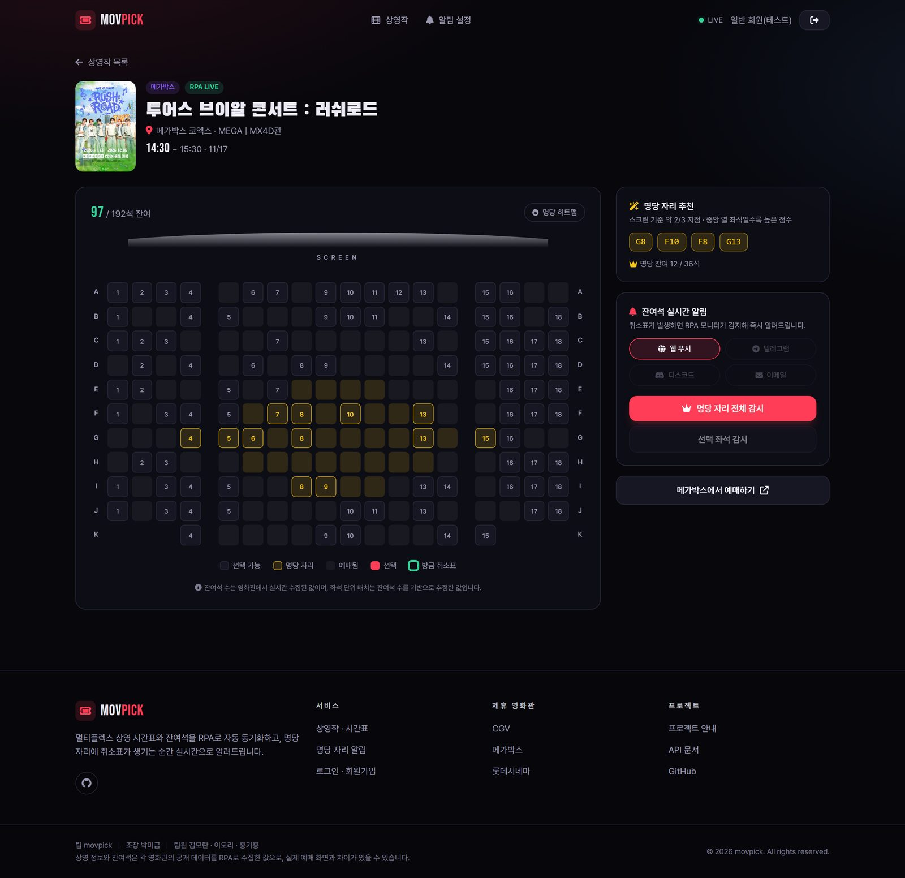
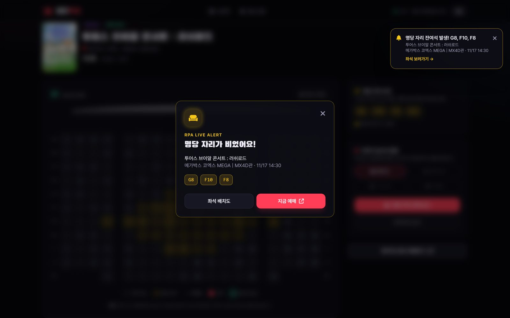
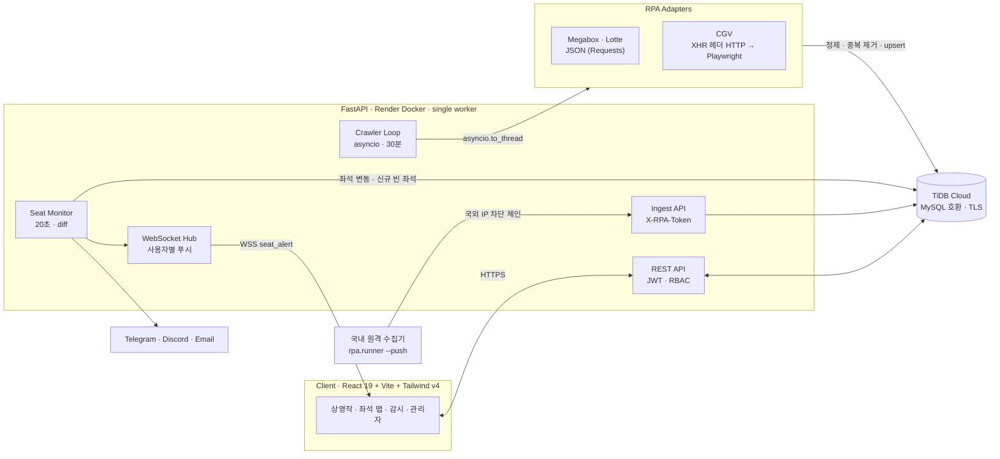

<div align="center">

# 🎬 movpick

### 명당 자리가 비는 순간, 가장 먼저 — RPA 기반 상영 시간표 동기화 · 명당 자리 실시간 예매 추천

멀티플렉스 3사(CGV · 메가박스 · 롯데시네마)의 상영 시간표와 잔여석을 **30분마다 자동 수집**하고,
좌석을 **명당 점수**로 평가한 뒤, 감시 중인 명당 자리에 **취소표가 생기면 WebSocket으로 즉시 알립니다.**

<br />

[](https://www.python.org/)
[](https://fastapi.tiangolo.com/)
[](https://playwright.dev/python/)
[](https://react.dev/)
[](https://vite.dev/)
[](https://tailwindcss.com/)
[](https://www.pingcap.com/tidb-cloud/)
[](Dockerfile)
<br />
[](https://github.com/fsclass-n/movpick/actions/workflows/ci.yml)
[](backend/tests)
[](https://movpick-api.onrender.com/docs)
[](https://movpick.netlify.app)
[](https://github.com/fsclass-n/movpick)
[](https://github.com/fsclass-n/movpick/issues)
[](https://github.com/fsclass-n/movpick/commits/main)

<br />

<a href="https://fsclass-n.github.io/movpick/"></a>
&nbsp;
<a href="https://movpick.onrender.com"></a>

<br /><br />

 

</div>

---

## 📌 TL;DR

| | |
|---|---|
| **문제** | 명당 자리는 매진 후 **취소표**로 풀리지만, 언제 풀릴지 알 수 없어 3사 앱을 반복 새로고침해야 함. 목록은 잔여석 **숫자**만 보여 줌 |
| **해결** | 수집은 RPA가, 감시는 서버가 — 사용자는 *"명당 자리가 비었다"*는 알림만 받는다 |
| **규모** | 3사 6개 지점 · 오늘+내일 · 하루 약 **450회차** 동기화 (30분 주기) · 좌석 감시 20초 주기 |
| **검증** | 좌석 비움 → 브라우저 팝업 **4.7초**(E2E 실측) · **pytest 24개** · CI(테스트 → 빌드 → Docker 이미지 기동 점검) |
| **역할 분리** | 일반 회원 / **읽기 전용** 테스트 관리자 / `.env` 실제 관리자 — 서버가 **403**으로 강제 |

> **테스트 계정** — 로그인 화면의 원클릭 버튼으로 바로 체험할 수 있습니다.
> 일반 회원 `user@movpick.app` / `Movpick!2026` · 시스템 관리자(읽기 전용) `admin@movpick.app`

---

## ✨ Key Features

| 기능 | 설명 | 구현 포인트 |
|---|---|---|
| **3사 상영 시간표 RPA 동기화** | 30분마다 오늘·내일 상영분과 잔여석 수집 | 체인별 어댑터 · HTTP 우선 → Playwright 폴백 · 체인 단위 실패 격리 |
| **명당 자리 추천** | 좌석 배치도에 명당 하이라이트 · 히트맵 · 추천 좌석 4석 | NumPy 거리 함수 점수, 상위 18%, 잔여석 수 기반 배치 재구성 |
| **실시간 취소표 알림** | 감시 등록 후 명당 자리가 비면 즉시 팝업 · 토스트 · OS 알림 | 좌석 diff 감지 → 사용자별 WebSocket · 텔레그램/디스코드/이메일 웹훅 |
| **인증 · 보안** | 이메일 가입(비밀번호 정규식), Google · Naver · Kakao OAuth, 원클릭 테스트 로그인 | JWT · bcrypt · OAuth state JWT 서명 · 복귀 Origin 화이트리스트 |
| **관리자 백오피스** | 크롤러 주기·실행·로그, 수집 진단, Plotly 성능 리포트, 회원 권한 실시간 변경 | 서버 측 RBAC, 권한 변경을 WebSocket으로 대상 사용자 화면에 즉시 반영 |

---

## 🏗 Architecture & Data Pipeline



**수집 → 정제 → 저장 → 추천 → 알림**

```text
[Scheduler 30m] ─▶ [Adapter per chain] ─▶ [Normalize]            ─▶ [Integrity policy]           ─▶ [TiDB upsert]
  오늘+내일          Megabox/Lotte: JSON     BS4 텍스트 정제           실데이터 有 → 실패해도 유지       (chain, external_id) UNIQUE
                     CGV: HTTP → Playwright  external_id 중복 제거      실데이터 無 → 모의 데이터 대체     crawl_logs(성공/실패·출처·ms)
                                                                     체인별 데모 모드(RPA_MOCK_CHAINS)
                                                       │
                                                       ▼
[Seat layout] 잔여석 수 → 배치 재구성(reconcile) ─▶ [Prime score] NumPy 상위 18% ─▶ [Monitor 20s] 새로 빈 좌석 ∩ 감시 대상 − 이미 알린 좌석
                                                                                            └─▶ WebSocket send_user · 웹훅
```

| 설계 결정 | 이유 | 트레이드오프 |
|---|---|---|
| 수집·감시를 API 프로세스 내 **asyncio 백그라운드 루프**로 | 무료 티어에서 별도 워커·큐 없이 운영, 배포 단위 단순화 | 워커 1개로 제한 → 확장 시 Redis Pub/Sub 분리 필요 |
| 동기 크롤러를 `asyncio.to_thread`로 실행 | Requests/Playwright sync API가 이벤트 루프(WebSocket)를 막지 않음 | 스레드당 브라우저 1개 — 동시 수집 대신 체인 순차 수집 |
| 프런트(정적 CDN) / API(Docker) / DB(TiDB) **분리 배포** | 장애·배포 영향 격리, 프런트는 Netlify·Render Static 이중화 | CORS · OAuth 복귀 Origin 화이트리스트 관리 필요 |
| 수집 위치와 수신 서버 분리 (`/api/rpa/ingest`) | 국외 IP를 차단하는 사이트도 국내 수집기로 대응 | 수집기 운영 환경이 별도로 필요 |

---

## 🧩 Key Technical Challenges & Solutions

### 1. 동적 페이지 · WAF 차단 대응과 Playwright 비용 최소화

| 단계 | 관찰 | 조치 |
|---|---|---|
| ① | CGV 스케줄 API에 일반 `curl` → **403** | Playwright로 예매 페이지를 연 뒤 **브라우저 컨텍스트 안에서 `fetch`** → 성공 |
| ② | 로컬에서 원인 분리: `Referer` · `Origin` · `Sec-Fetch-*`를 갖춘 요청은 **브라우저 없이도 200** | **HTTP 우선 → 실패 시 Playwright 폴백** 2단계 어댑터로 변경 — Chromium 기동 비용 제거, 512MB 무료 서버 메모리 절약 |
| ③ | Render 배포 후 두 방식 모두 **403** | Cloudflare `cf-ray` 접속 거점 비교: 국내 **ICN 통과 / 미국 PDX 차단** → 헤더가 아닌 **국외 IP 차단**으로 결론 |
| ④ | 서버 직접 수집 불가 | 국내 원격 수집기 → **토큰 인증 수신 API**(`secrets.compare_digest`) 구조로 전환, 관리자 **수집 진단**(저장 없는 실접속 테스트), 국내 VM 원클릭 설치 스크립트(사전 점검 포함) |

- Headless Chromium은 **빌드 타임**에 이미지에 설치(`playwright install --with-deps chromium`), 국내 수집기 전용 이미지는 `INSTALL_BROWSER=false` 경량 빌드
- `python:3.11-slim`이 Debian 13으로 바뀌어 Playwright 의존성 설치가 깨진 문제 → `slim-bookworm` 고정, CI 러너도 `ubuntu-24.04` 고정

### 2. 30분 주기 동기화 · 중복 처리 · 정합성

- **멱등 적재**: `(chain, external_id)` UNIQUE + upsert. 롯데시네마 응답의 **중복 회차**가 UNIQUE 위반을 일으켜 전체 루프가 멈춘 사례 → 적재 전 `external_id` 기준 중복 제거 + **체인·일자 단위 실패 격리**
- **실데이터 보호 정책**: 수집이 실패해도 해당 일자 실데이터가 있으면 **모의 데이터로 덮지 않음**(TTL 180분 초과 시 '갱신 지연' 표시). 실데이터가 도착하면 같은 일자 모의 회차를 정리해 **혼재 방지**
- **좌석 배치 보정**: 재수집 시 잔여석 수에 맞춰 기존 배치를 **최소 변경**(reconcile) — 감시 중인 좌석 상태가 불필요하게 흔들리지 않음
- **시간대**: DB `now()` 기본값(UTC)과 상영 시각(KST)이 9시간 어긋난 문제 → 앱 측 로컬 시각 기록 + 컨테이너 `TZ=Asia/Seoul`
- **관측성**: `crawl_logs`(성공/실패 · 출처 real/mock · 건수 · 소요 ms · 트리거) + Plotly 리포트 · `/health`가 배포 커밋 해시를 반환

### 3. 명당 추천 · 추천 이유 산출 로직

```text
# rpa/seatmap.py — 스크린 기준 약 62% 깊이 · 중앙 열에 가까울수록 높은 점수
r0, c0 = (rows - 1) * 0.62, (cols - 1) / 2
dr, dc = |r - r0| / (rows - 1), |c - c0| / (cols - 1)
score  = clip(1 - (1.6 * dr + 1.4 * dc) ** 1.2, 0, 1)      # 명당 = 상위 18%
```

- **배치 재구성**: 영화관은 잔여석 *수*만 공개 → 총 좌석 수에 맞게 배치를 만들고(뒷줄 양끝 제거), 점유 좌석은 `(0.35 + score)³` 가중 샘플링으로 *명당부터 팔리는* 분포를 재현. **추정값임을 UI에 명시**
- **추천 좌석**: 현재 비어 있는 명당 중 점수 상위 4석 → "왜 이 자리인지"를 점수·히트맵으로 시각화
- **인기 순위**: 예매율만 쓰면 회차 1개짜리 영화가 1위로 튀는 왜곡 → **판매 좌석 수 합계**(pandas) 기준 + 실데이터 우선
- **알림 대상 산출**: `현재 빈 좌석 ∩ 감시 대상(명당 전체 | 선택 좌석) − last_notified` → **새로 빈 좌석만** 해당 사용자에게 전송(중복 알림 방지)

### 4. 운영 환경 이슈

| 증상 | 원인 | 해결 |
|---|---|---|
| Google 로그인 `redirect_uri_mismatch` | 운영 `BACKEND_URL`이 localhost로 남음 | 프록시 헤더를 반영한 **요청 기준 콜백 URL** 생성 (명시적 공개 URL은 우선) |
| 소셜 로그인 후 404 | 정적 호스팅에 SPA 리라이트 부재 | 결과를 루트(`/#oauth_token=`)로 받아 호스팅 설정과 무관하게 동작 |
| 테스트 관리자 계정 공개 위험 | 비밀번호가 화면에 노출되는 데모 계정 | **읽기 전용** — 쓰기 API는 서버가 403, 실제 관리자는 `.env`로만 생성(강등 불가) |

---

## 🛠 Tech Stack

| 영역 | 기술 | 선택 이유 |
|---|---|---|
| **Backend** | Python 3.11 · FastAPI · SQLAlchemy 2 · Pydantic · PyJWT · bcrypt · httpx | 비동기 + WebSocket 기본 지원, 입력 검증, Swagger 자동 문서 |
| **Frontend** | React 19 · Vite 6 · Tailwind CSS v4(`@theme` 토큰) · React Router 7 · FontAwesome | 좌석 맵·실시간 상태 컴포넌트화, 디자인 토큰 일원화 |
| **RPA / Data** | Playwright(Chromium) · Requests · BeautifulSoup4 · NumPy · pandas · Plotly | 가벼운 HTTP 우선, WAF 시 실제 브라우저 · 좌석 점수 벡터 연산 · 집계 · 리포트 |
| **Database** | TiDB Cloud (MySQL 호환, TLS) · 테스트는 임시 SQLite | 로컬·운영 동일 DB로 환경 차이 제거, 테스트는 운영 DB와 격리 |
| **Realtime** | WebSocket(사용자별 채널, 지수 백오프 재연결) · Telegram · Discord · SMTP | 브라우저 팝업 + 외부 채널 동시 알림 |
| **Infra / CI** | Docker · Docker Compose · Render(API · Static) · Netlify · GitHub Actions · GitHub Pages | 빌드 타임 Chromium, 프런트/백 독립 배포, CI 품질 게이트 |

---

## 🔌 API Architecture

| 그룹 | 엔드포인트 | 설명 |
|---|---|---|
| Auth | `POST /api/auth/signup` · `/login` · `/demo/{user\|admin}` · `GET /me` · `/providers` | 이메일·테스트 로그인, JWT 발급 |
| OAuth | `GET /api/auth/oauth/{google\|naver\|kakao}/login` · `/callback` | state JWT 서명, Origin 화이트리스트 복귀 |
| Showtimes | `GET /api/showtimes` · `/api/showtimes/{id}` · `/api/showtimes/{id}/seats` · `/api/movies` · `/api/chains` | 시간표 · 좌석 배치 · 명당 · 추천 좌석 |
| Stats | `GET /api/stats/booking-rates` | 판매 좌석 기준 인기 순위 · 체인별 예매율 |
| Watches | `GET·POST /api/watches` · `PATCH·DELETE /api/watches/{id}` · `GET /api/watches/channels` | 명당/선택 좌석 감시, 알림 채널 |
| Admin | `GET /api/admin/users` · `PATCH /users/{id}/role` · `GET·PUT /crawler` · `POST /crawler/run` · `POST /crawler/probe` · `GET /crawler/logs` · `/reports/crawl` · `/summary` | RBAC — 쓰기는 읽기 전용 계정 403 |
| RPA Ingest | `POST /api/rpa/ingest` · `GET /api/rpa/ping` | 원격 수집기 데이터 수신(`X-RPA-Token`) |
| Realtime · Ops | `WS /ws?token=` · `GET /health` | `seat_alert` · `seat_update` · `role_changed` · 배포 커밋 확인 |

전체 명세: **[movpick-api.onrender.com/docs](https://movpick-api.onrender.com/docs)** (Swagger)

---

## 📂 Directory Structure

```text
movpick/
├── backend/app/
│   ├── main.py              # FastAPI 앱 · lifespan(DB 초기화 · 크롤러/모니터 루프) · /ws · /health
│   ├── config.py · db.py    # 단일 .env 설정 · TiDB(TLS) / SQLite 폴백
│   ├── models.py            # User · Showtime · SeatWatch · CrawlLog
│   ├── security.py          # JWT · bcrypt · 비밀번호 정규식 · require_admin / require_admin_write
│   ├── routers/             # auth · showtimes · watches · admin · rpa(ingest)
│   └── services/            # crawler(동기화 · 정합성 정책) · monitor(좌석 diff) · notifier(웹훅) · ws(허브)
├── backend/tests/           # pytest 24개 (인증 · RBAC · 좌석 모델 · 수신 API · 정합성 · OAuth)
├── rpa/
│   ├── adapters/            # cgv(HTTP → Playwright) · megabox · lotte · mock
│   ├── seatmap.py           # 배치 재구성 · 명당 점수 · 변동 시뮬레이션
│   ├── service.py           # crawl_chain(auto | real | mock)
│   └── runner.py            # CLI · 원격 수집기(--push · --every)
├── frontend/src/            # pages(Home · Showtime · Alerts · Admin · Login) · components · context(Auth · Realtime · Toast)
├── scripts/                 # 국내 VM 수집기 설치 · Windows 수집기
├── docs/                    # 발표자료 · 산출물 · 진행일지 · video/(10분 영상 · 제작 도구)
├── index.html · assets/     # GitHub Pages 포트폴리오
├── Dockerfile · docker-compose.yml · render.yaml · netlify.toml
└── .github/workflows/       # ci · pages · cgv-collector
```

---

## ✅ Quality

- **pytest 24개** — 비밀번호 규칙, 좌석 배치 정원·잔여석 일치, 가입/로그인, RBAC(읽기 전용 403 · `.env` 관리자 보호), 감시 → 알림 diff, 수신 API 토큰, 실데이터 보호·혼재 방지, OAuth `redirect_uri` 생성
- **CI** — `backend`(pytest, RPA 비활성 · 임시 DB) → `frontend`(build) → `docker`(API 이미지 + 경량 수집기 이미지 빌드, 컨테이너 `/health` 기동 점검) → `deploy`
- **E2E** — Playwright로 실시간 알림(4.7초) · 4개 해상도 반응형 · 10분 시연 영상 자동 녹화

## 🚀 Quick Start

```bash
cp .env.example .env                       # TiDB 미설정 시 SQLite로 동작
py -3.11 -m venv .venv && .venv/Scripts/python -m pip install -r requirements.txt
.venv/Scripts/python -m playwright install chromium
.venv/Scripts/python -m uvicorn backend.app.main:app --reload --port 8000
cd frontend && npm ci && npm run dev       # http://localhost:5173
```

환경 변수 · 배포 · 원격 수집기 설정은 **[docs/DEVELOPMENT.md](docs/DEVELOPMENT.md)** 를 참고하세요.

## ⚠️ Known Limitations

- 영화관은 잔여석 **수**만 공개하므로 좌석 단위 배치는 **추정값**입니다(화면에 표기). 크롤링 사이 구간의 취소표는 시뮬레이션됩니다.
- CGV는 국외 IP를 차단하므로 **국내 수집기**가 필요합니다. 수집기가 없으면 체인별 데모 모드로 운영합니다.
- 수집·감시 루프가 API 프로세스 안에 있어 **단일 워커**로 운영합니다(확장 계획: Redis Pub/Sub, Alembic 마이그레이션).

## 👥 Team

**Team movpick** — 박미금(조장) · 김모란 · 이오리 · 홍기흥
