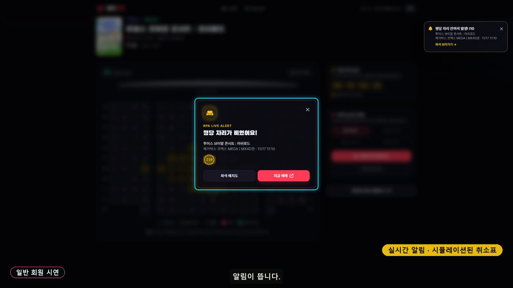

# movpick

> **명당 자리가 비는 순간, 가장 먼저 알려드려요**
> RPA 기반 영화 상영 시간표 자동 동기화 및 명당 자리 실시간 예매 추천 플랫폼

## 🎬 포트폴리오 바로가기

### 👉 [https://fsclass-n.github.io/movpick/](https://fsclass-n.github.io/movpick/)

## 소개

CGV · 메가박스 · 롯데시네마의 상영 시간표와 잔여석을 RPA로 자동 수집하고, 명당 자리를 점수로 고른 뒤,
취소표가 생기면 WebSocket으로 즉시 알려 주는 영화 예매 추천 플랫폼입니다. (팀 movpick · 박미금 · 김모란 · 이오리 · 홍기흥)

## 포트폴리오에서 볼 수 있는 것

| 구성 | 내용 |
|---|---|
| 발표·시연 영상 | 10분 본편 · 60초 하이라이트 · 5개 챕터 — 썸네일을 누르면 그 자리에서 재생 |
| 프로젝트 | 기획 의도 · 핵심 기능(RPA 동기화 · 명당 점수 모델 · 실시간 취소표 알림 · 권한 분리) · 제작 과정 |
| 실제 화면 | 운영 서비스 캡처(데스크톱 · 모바일) |
| 아키텍처 | React · FastAPI · TiDB · Playwright · Docker · Render · Netlify · GitHub Actions와 선택 이유 |
| 문제 해결 | CGV 국외 IP 차단 진단, 녹화 시간 어긋남, OAuth·정적 호스팅 이슈, 데이터 정합성 |

## 링크

[운영 서비스](https://movpick.onrender.com) · [API 문서](https://movpick-api.onrender.com/docs) ·
[발표자료](docs/프로젝트_발표자료.pptx) · [영상](docs/video/movpick_final.mp4) · [개발 문서(실행 · 배포)](docs/DEVELOPMENT.md)
